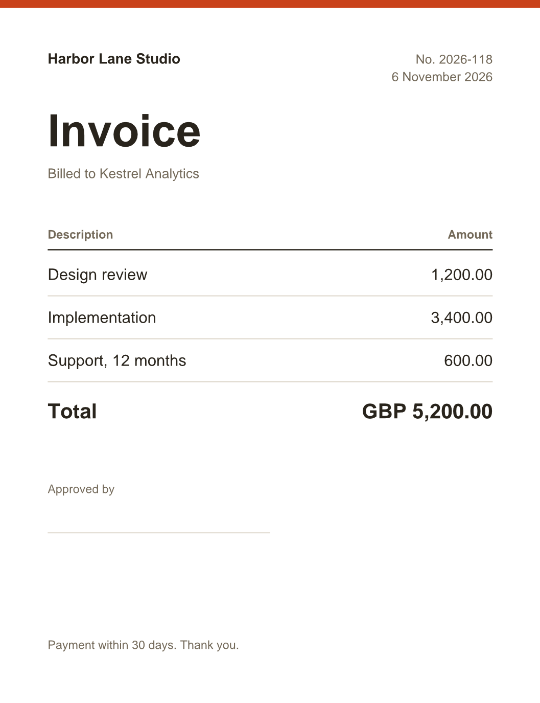
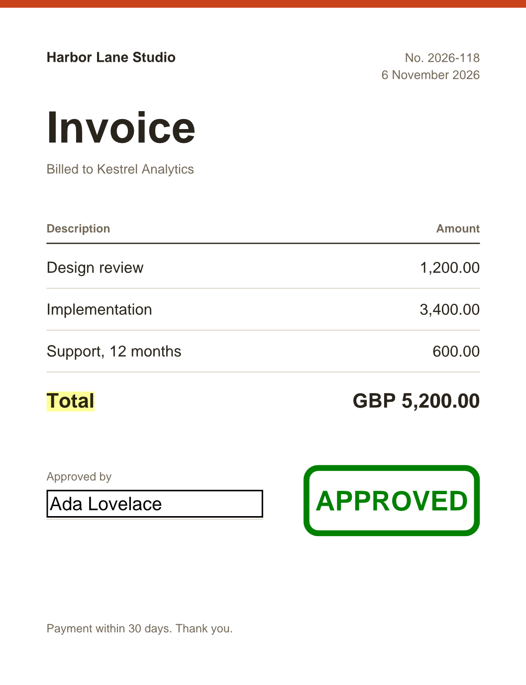

# pyropdf

**Read, render, and edit PDFs in Python. Undo your edits.**

pyropdf combines a Python API with a Rust core: extract text and tables,
render pages, fill forms, and annotate documents in one package.
Transactions group edits into one undoable step; a failed transaction
leaves the document as it was.

[](https://pypi.org/project/pyropdf/)
[](https://pypi.org/project/pyropdf/)
[](https://github.com/yhay81/pyropdf/blob/main/LICENSE)

[Documentation](https://pyropdf.haya.works/) ·
[Recipes](https://pyropdf.haya.works/recipes/) ·
[API reference](https://pyropdf.haya.works/api/) ·
[Choosing a PDF library](https://pyropdf.haya.works/choosing/) ·
[Japanese docs](https://pyropdf.haya.works/ja/)

## See it work

| Read an invoice | Highlight, fill, and stamp it |
| --- | --- |
|  |  |

These are real pyropdf renders. [Walk through the four steps](https://pyropdf.haya.works/),
[open the resulting PDF](https://pyropdf.haya.works/assets/hero/reviewed.pdf),
or [reproduce the images](https://github.com/yhay81/pyropdf/blob/main/tools/hero_invoice.py).

## Try it

Python 3.11–3.15 on Linux, macOS, and Windows, including free-threaded
CPython. No required dependencies; OCR and CJK fallback fonts are optional
[extras](https://pyropdf.haya.works/getting-started/#install).

```bash
pip install pyropdf
```

Run this in an empty directory. It creates its own PDF, highlights the
total, renders a preview, undoes and redoes the highlight, and saves the
result. No sample download or account is needed.

```python
import pyropdf

with pyropdf.Document() as doc:
    page = doc.pages.new((360, 240))
    with page.draw() as canvas:
        canvas.text("Invoice total: $42", (30, 60),
                    font=pyropdf.Font.standard("Helvetica"), size=20)
    source = doc.to_bytes()

with pyropdf.open(source) as doc:
    page = doc.pages[0]
    print(page.text().strip())
    with doc.transaction("highlight total"):
        page.annotations.add(pyropdf.Highlight(page.search("$42")))
    page.pixmap(dpi=144).save("reviewed.png")

    doc.history.undo()
    print("After undo:", len(page.annotations))
    doc.history.redo()
    doc.save("reviewed.pdf", incremental=True)
```

Output:

```text
Invoice total: $42
After undo: 0
```

Open `reviewed.png` or `reviewed.pdf` to see the highlighted total.
For an existing file, use `pyropdf.open("input.pdf")`.

## What can I build?

| Task | Start here |
| --- | --- |
| Extract text, words, tables, Markdown, or retrieval chunks | [Reading content](https://pyropdf.haya.works/reading/) |
| Turn PDF pages into PNG, JPEG, or SVG | [Rendering](https://pyropdf.haya.works/rendering/) |
| Fill forms, highlight text, stamp pages, or draw content | [Editing](https://pyropdf.haya.works/editing/) |
| Read scanned documents with offline OCR | [OCR](https://pyropdf.haya.works/reading/#offline-ocr) |
| Undo/redo edits, save incrementally, encrypt, or sign | [Versions and saving](https://pyropdf.haya.works/versions/) |

## Why pyropdf?

- **Reversible edits.** Group changes in a named transaction and undo or
  redo them through `doc.history`. Exceptions discard the whole transaction.
- **One document for reading, rendering, and editing.** All engines read
  the same versioned object store. Preview an edit before saving it.
- **Incremental saves.** Append changed objects while keeping the original
  file's bytes intact. Inspect `doc.changes` before saving.
- **MIT licensed.** Use it in open-source or commercial applications.

[Choosing pyropdf](https://pyropdf.haya.works/choosing/) compares capabilities
and limitations with PyMuPDF, pypdf, and pikepdf.
[DESIGN.md](https://github.com/yhay81/pyropdf/blob/main/DESIGN.md) explains the architecture.

## Status and limits

**0.3 series, alpha.** The API may change between minor versions.
[Release notes](https://github.com/yhay81/pyropdf/blob/main/CHANGELOG.md)
describe each release. See [status and safety](https://pyropdf.haya.works/status/)
for current coverage and limitations.

No pyropdf release claims safety for untrusted input before hayro's bounded
construction (I2, [#15](https://github.com/yhay81/pyropdf/issues/15)) is
released. `DocumentLimits` bounds the work of an operation, but it is not
that claim.

## Contributing

For your first contribution, browse the [available good first issues](https://github.com/yhay81/pyropdf/issues?q=is%3Aissue+is%3Aopen+label%3A%22good+first+issue%22+-label%3Ain-progress)
and leave a comment on the one you would like to take.

[CONTRIBUTING.md](https://github.com/yhay81/pyropdf/blob/main/CONTRIBUTING.md)
explains how to build, test, and propose a change, and
[SECURITY.md](https://github.com/yhay81/pyropdf/blob/main/SECURITY.md)
how to report a vulnerability.

If pyropdf is useful to you, [star the repository](https://github.com/yhay81/pyropdf)
to find it again. A small reproducible example in an
[issue](https://github.com/yhay81/pyropdf/issues) helps improve it for your use case.
