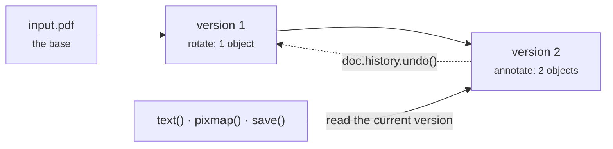

# Concepts

## Choosing the operation for a task

| Task | Python operation | Which PDF data it works on |
| --- | --- | --- |
| Inspect a file or start editing | `probe(source)`, `open(source)`, `Document()` | A probe returns a small frozen summary. Opening gives you a document backed by the file. The constructor creates an empty document. |
| Find, move or copy a page | `doc.pages[index]`, `pages.move`, `pages.insert`, `pages.extend` | An index is a position. A page handle keeps its identity through a move. Insertion copies pages, including pages from another document. Page labels are display strings and named pages are catalog entries. |
| Read text, layout or paint order | `page.text()`, `page.words()`, `page.layout()`, `page.content()` | Plain text, word boxes, lines and spans, and painted items serve different consumers. `page.chars()` and `page.paths()` provide columnar access. `page.operations` exposes encoded drawing instructions for editing. |
| Export selected pages for retrieval | `doc.text(pages)`, `doc.markdown(pages)`, `doc.to_json(pages)`, `doc.to_chunks(pages)` | The document selects pages from one version. Choose plain text, Markdown, serialized page elements or typed chunks with boundaries. `page.search()` and `page.selection()` locate material on one page. |
| Add visible content or an overlay | `with page.draw() as canvas`, `page.annotations.add(spec)` | The canvas writes to the page content stream on clean exit. An annotation has its own rectangle and appearance. `page.links.add(rect, target)` creates a navigable link. |
| Render or extract an image | `page.pixmap()`, `doc.render(pages)`, `page.svg()`, `page.images()` | Rasterize one page, render a batch, export a vector page, or list individual image occurrences. An occurrence offers decoded pixels via `pixmap()` and stored image bytes via `stored()`. Image replacement addresses the shared object by xref. |
| Inspect or supply fonts | `page.fonts()`, `doc.font_program(font)`, `doc.fallback_fonts` | These list resources, extract a particular embedded program, and configure substitution. Supply a drawing face to the canvas when authoring text. |
| Fill a field or change its appearance | `doc.form[name].value`, `page.widgets[index]` | A field holds the shared value. Its widgets describe individual controls on pages. `page.widgets.add(spec)` creates one. FDF/XFDF imports apply values to matching fields. |
| Read or replace an embedded file | `doc.attachments[name]`, `annotation.file` | The former resolves a catalog name-tree entry, the latter the file specification of a page annotation. `doc.collection` describes how a portable collection presents its files. Currently an attachment handle follows a replacement at the same name. |
| Navigate the document | `doc.outline`, `doc.destinations`, `doc.threads`, `doc.structure` | Bookmarks point to targets, named destinations resolve names, article threads order page regions, and the structure tree describes logical reading order. Actions and triggers belong to the document, page, annotation or field that owns the event. |
| Edit metadata or check conformance | `doc.metadata`, `doc.xmp`, `doc.profiles`, `doc.check()` | The Info mapping edits standard fields and updates matching XMP properties. The packet is XML. Profiles read declarations and output intents. The structural check reports defects; an external validator tests conformance. |
| Read a PDF/A declaration | `doc.profiles.pdfa`, `doc.pdfa_claim` | Use the normalized name for display or comparison, e.g. `"PDF/A-2B"`. For the numeric part and original conformance spelling use the pair, e.g. `(2, "b")`. A part without conformance yields `(4, "")` for part 4. Both return `None` for a missing claim. |
| Inspect an object or change a PDF feature | `doc.objects[xref]`, `typed.Catalog(doc.catalog)`, or the feature's handle | Raw values preserve PDF names, strings and references. An Arlington view interprets schema keys. A feature edit such as `field.value = text` also maintains its dependents, including widget appearances. |
| Measure geometry or a mapped region | `rect.top_left`, `point in rect`, `rect.round()`, `rect.area(unit="cm")`, `page.viewports` | Rectangle coordinates are in display points. Unit conversion uses the named unit. A viewport is a PDF measurement region and may describe its own coordinate system. `abs(point)` and `abs(matrix)` give their Euclidean magnitudes. |
| Recognize scanned text | `page.ocr()`, `page.apply_ocr(words=words)` | Recognition returns positioned words. Applying the result writes searchable text into the document. `OcrEngine.recognize` accepts an image directly. |
| Change page appearance or remove information | `page.recolor(target)`, `doc.rewrite_images()`, `page.clean_contents()`, `doc.flatten()`, `doc.sanitize(path)` | Recolor paint, rewrite image resources, clean content streams, paint annotations into pages, or remove selected sensitive features before saving. Whole-document and single-page operations have different scopes. |
| Set visibility or viewing preferences | `doc.layers`, `doc.viewer_preferences`, `page.transition`, `doc.requirements` | Layer configuration controls optional content. The other values describe viewer settings, a page transition, and capabilities requested by the document. |
| Control access and work limits | `open(source, password=..., limits=...)`, `doc.unlock(password)`, `doc.save(path, encryption=...)` | Supply credentials at open or unlock the open document. Encryption on save sets the output policy. `DocumentLimits` bounds document operations and keyword-only `max_*` parameters limit individual results. |
| Review, sign and persist changes | `doc.history`, `doc.revisions`, `doc.changes(incremental=True)`, `doc.signatures`, `doc.save(path)`, `doc.to_bytes()` | History holds undo steps in memory. Revisions are the file's incremental saves. Changes predict effects on claims and signed objects. Signature verification examines an existing signature. Choose a file or bytes as the save destination. |

Views such as `pages`, `form` and `metadata` reflect subsequent edits.
Sequence views accept negative indices and slices where documented. A lookup
of an absent mapping key raises `KeyError`. A result such as `Profiles` is a
frozen record with named fields. When constructing one yourself, use keywords.
For a drawing or creation specification, pass the operands shown in its
signature, as in `TextField("address", rect)`.

## Trace a retrieval result to its source

For a PDF containing directly drawn text, start with a returned chunk and read its stored text-showing operation.

```python
import pyropdf

with pyropdf.open("input.pdf") as doc:
    chunks = doc.to_chunks(provenance=True)
source = next(
    source for chunk in chunks for element in chunk.elements
    for source in element.sources if source.operation is not None
)
operation = source.resolve()
assert operation is not None
print(source.page, source.page_xref, source.bbox, source.stream, source.operation)
print(operation.operator, operation.operands)
```

The zero-based page and operation indexes belong to the immutable version held by `source.version`. The resolver continues to read that version after edits or closure. `version.same_as(other)` compares two captured versions, including uncommitted edits. Every grouped or split text element keeps its individual glyph locations in display space. A multi-character glyph keeps its original box when a split cuts its Unicode mapping.

`kind="inferred"` identifies layout spacing or table structure. A glyph from a nested Form or an annotation appearance can have a display box with `kind="unresolved"` when the interpreter supplies no operator identity. Painted images retain their known image object number. This export uses PDF extraction and does not run OCR. `doc.to_json(provenance=True)` serializes these locations and indexes. For a known PDF operator, `operation_sha256` identifies its exact stored bytes, including their original spelling and spacing. The live version reader is available on the Python chunk objects.

## Display coordinates

Every rectangle and point in the API, the boxes of words and search hits,
annotation rectangles, `clip`, and the page boxes, is in **display
coordinates**: points of 1/72 inch, with the origin at the top-left corner
of the visible page and `y` growing downward. The visible page is the
CropBox clipped to the MediaBox, with the page's rotation applied, so
`page.rect` is `(0, 0, width, height)` as a viewer shows it.

A page's `/UserUnit` (PDF 1.6) sets the size of its user space unit in
multiples of 1/72 inch, so that a page can be larger than 200 inches.
pyropdf applies it wherever it converts: a page whose MediaBox is
`[0 0 400 300]` with `/UserUnit 2` is 800 by 600 points in `page.rect`,
its boxes, text, paths, annotations, and canvas, and renders 800 by 600
pixels at 72 dpi. A missing unit, or one that is not a positive number,
is 1.

PDF's own space has its origin at the bottom-left of the MediaBox and does
not rotate; pyropdf converts for you, so a rectangle found by `search` can go
straight into an annotation. To map a rectangle to the pixels of a render,
scale by `dpi / 72`:

```python
import pyropdf

with pyropdf.open("input.pdf") as doc:
    page = doc.pages[0]
    dpi = 144
    pixmap = page.pixmap(dpi=dpi)
    x0, y0, x1, y1 = (value * dpi / 72 for value in page.words()[0].bbox)
    print(pixmap.width, round(x0), round(y0), round(x1), round(y1))
```

## Versions

A document is the file it opened, the base, and a chain of versions above
it. An edit writes only the objects it changes into a new version; the rest
stay shared with the versions below. Readers, renderers, and saves all work
on the current version, so an edit is visible to the next `text()` or
`pixmap()` without saving, and a result that depends only on a version is
computed once for it.



`doc.history` keeps the steps that undo and redo walk. Each step holds the
objects that it replaced, and `doc.history.size` counts their bytes:
`doc.history.max_size` bounds them, and `doc.history.clear()` forgets the
steps while keeping the document as it is.

## Handles

A `Page`, `Annotation`, `Field`, or object handle names a thing, not a
position. A page handle follows its page when pages move, and reads
whatever the current version says about it, also after an undo. Once its
page is gone, using it raises `StalePageError`; objects raise
`StaleObjectError` the same way.

```python
import pyropdf

with pyropdf.open("input.pdf") as doc:
    first = doc.pages[0]
    doc.pages.move(0, 1)
    print(first.index)           # 1: the handle followed its page
    del doc.pages[1]
    try:
        first.text()
    except pyropdf.StalePageError:
        print("the page is gone")
```

## Transactions

`doc.transaction(name)` makes the edits of its block one step. If the block
raises, the document returns to the version before it; nothing is copied to
make that possible. Edits outside a transaction are a step each.
[Versions and saving](versions.md) shows both.

## Threads

Several threads may read one document at once: a read holds a lock only
to take the current version, then works without it. Writes are serialized
and publish complete versions, so a long render keeps reading the version
that it started with while another thread edits. Rendering, text, and
other heavy reads release the GIL, and pyropdf ships wheels for the
free-threaded builds of CPython.

```python
from concurrent.futures import ThreadPoolExecutor

import pyropdf

with pyropdf.open("input.pdf") as doc, ThreadPoolExecutor() as pool:
    texts = list(pool.map(lambda page: page.text(), doc.pages))
    print(len(texts))
```

`doc.render` already renders pages on several threads.

## Cost

- Opening reads the cross-reference data, not every object; `probe` reads
  less still.
- An edit costs what it touches: rotating a page writes one object.
- An incremental save appends only the objects that the edits wrote; a full
  save rewrites the file.
- `DocumentLimits` bounds the work of each operation; see
  [Limits and errors](limits.md).
