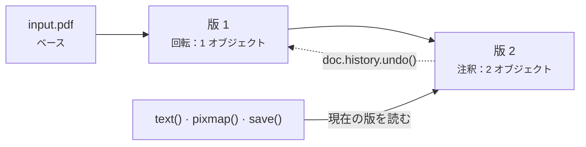

# 概念

## 目的別の API

| 目的 | Python の操作 | 対象と使い分け |
| --- | --- | --- |
| ファイルの概要を読む、編集を始める | `probe(source)`、`open(source)`、`Document()` | 概要だけなら `probe` を使います。既存ファイルの読み書きには `open`、空の文書の作成にはコンストラクターを使います。 |
| ページを探す、移動する、複製する | `doc.pages[index]`、`pages.move`、`pages.insert`、`pages.extend` | インデックスは現在の位置です。移動するとハンドルは同じページを追います。挿入はページを複製し、別の文書からも取り込めます。ページラベルは表示用の文字列、名前付きページはカタログの項目です。 |
| テキスト、レイアウト、描画順を読む | `page.text()`、`page.words()`、`page.layout()`、`page.content()` | 順に本文、単語と座標、行やスパン、描画順の項目を返します。`page.chars()` と `page.paths()` は列単位で参照できます。描画命令を編集するときは `page.operations` を使います。 |
| 選択したページを検索用に書き出す | `doc.text(pages)`、`doc.markdown(pages)`、`doc.to_json(pages)`、`doc.to_chunks(pages)` | 同じバージョンのページから本文、Markdown、要素の JSON、区切り付きのチャンクを得られます。ページ内の位置を求めるには `page.search()` や `page.selection()` を使います。 |
| ページへ描画する、注釈を付ける | `with page.draw() as canvas`、`page.annotations.add(spec)` | 描画はブロックの正常終了時にページのコンテンツへ書き込みます。注釈には独自の矩形と外観があります。リンクは `page.links.add(rect, target)` で作ります。 |
| ページを描画する、画像を取り出す | `page.pixmap()`、`doc.render(pages)`、`page.svg()`、`page.images()` | それぞれ単一ページのピクセル、複数ページの描画、ベクター形式、個々の画像の配置を扱います。配置の `pixmap()` はデコード済みピクセル、`stored()` は格納された画像データを返します。共有画像の置換には xref を使います。 |
| フォントを調べる、指定する | `page.fonts()`、`doc.font_program(font)`、`doc.fallback_fonts` | ページのフォント資源、埋め込みプログラム、代替フォントの設定を扱います。文字を描くフォントはキャンバスに渡します。 |
| フォームの入力値や外観を変える | `doc.form[name].value`、`page.widgets[index]` | 値はフィールドが共有し、各ページの位置や外観はウィジェットが持ちます。`page.widgets.add(spec)` で新しく作れます。FDF/XFDF の読み込みは対応するフィールドへ値を反映します。 |
| 埋め込みファイルを読む、置き換える | `doc.attachments[name]`、`annotation.file` | 前者はカタログの名前ツリーの項目、後者はページ上の注釈が指すファイルです。`doc.collection` はポートフォリオの表示方法を表します。現在、添付ファイルのハンドルは同じ名前で再登録されたファイルを参照します。 |
| 文書内の移動先や読む順番を調べる | `doc.outline`、`doc.destinations`、`doc.threads`、`doc.structure` | しおり、名前付きの移動先、記事を構成する領域の順番、論理的な読み順をそれぞれ扱います。イベントのアクションは、その文書・ページ・注釈・フィールドで指定します。 |
| メタデータを編集する、適合性を調べる | `doc.metadata`、`doc.xmp`、`doc.profiles`、`doc.check()` | Info の標準項目を編集すると対応する XMP の値にも反映されます。XML 自体は XMP で、適合宣言と出力インテントは profiles で読めます。構造検査は欠陥を報告します。規格への適合判定には外部の検証器を使います。 |
| PDF/A の宣言を読む | `doc.profiles.pdfa`、`doc.pdfa_claim` | 表示や比較には大文字に統一した名前（例 `"PDF/A-2B"`）を使います。部番号と元の綴りが必要なときは組（例 `(2, "b")`）を使います。部番号 4 のみの宣言は `(4, "")`、宣言がなければどちらも `None` です。 |
| PDF オブジェクトを調べる、機能を編集する | `doc.objects[xref]`、`typed.Catalog(doc.catalog)`、機能別のハンドル | 生の値は PDF の名前・文字列・参照を扱い、Arlington のビューはスキーマに従ってキーを解釈します。`field.value = text` などの機能別操作はウィジェットの外観など関連項目も更新します。 |
| 図形や領域を測る | `rect.top_left`、`point in rect`、`rect.round()`、`rect.area(unit="cm")`、`page.viewports` | 矩形の座標は表示空間のポイントです。単位換算にはキーワード引数を使います。ビューポートは独自の座標系を持てる PDF の測定領域です。点や行列の大きさは `abs(point)`、`abs(matrix)` で得られます。 |
| スキャン画像から文字を認識する | `page.ocr()`、`page.apply_ocr(words=words)` | 認識すると位置付きの単語が得られます。結果を適用すると文書に検索可能なテキストを追加します。画像を直接渡すときは `OcrEngine.recognize` を使います。 |
| ページの外観を変える、情報を除去する | `page.recolor(target)`、`doc.rewrite_images()`、`page.clean_contents()`、`doc.flatten()`、`doc.sanitize(path)` | それぞれ色の変換、画像資源の書き換え、コンテンツストリームの整理、注釈のページへの描き込み、指定した情報の除去と保存を行います。ページ単位と文書単位の操作を選べます。 |
| 表示条件を決める | `doc.layers`、`doc.viewer_preferences`、`page.transition`、`doc.requirements` | レイヤーの構成はコンテンツの表示・非表示を制御します。ほかの値はビューアーの設定、ページ切り替え効果、文書が要求する機能を表します。 |
| アクセスと処理量を制御する | `open(source, password=..., limits=...)`、`doc.unlock(password)`、`doc.save(path, encryption=...)` | 開くときに資格情報を渡すか、開いた文書を後から解除できます。保存時に暗号化を指定します。`DocumentLimits` は文書操作、キーワード引数の `max_*` は個々の結果に上限を設けます。 |
| 編集内容を確認し、署名・保存する | `doc.history`、`doc.revisions`、`doc.changes(incremental=True)`、`doc.signatures`、`doc.save(path)`、`doc.to_bytes()` | history は編集中の取り消し履歴、revisions はファイルに残る増分保存の世代です。changes は適合宣言と署名対象への影響を報告します。署名そのものも検証できます。保存先はファイルかバイト列を選びます。 |

`pages`、`form`、`metadata` などのビューには後から行った編集も反映されます。
シーケンスでは各 API に記載の範囲で負のインデックスやスライスを使えます。
マッピングにないキーを参照すると `KeyError` になります。`Profiles` などの結果は
フィールド名を持つ変更不能なレコードです。自分で組み立てるときはキーワード引数を使います。
描画や作成の指定には `TextField("address", rect)` のように各シグネチャに従って引数を渡します。

## 検索結果から元の命令をたどる

ページのコンテンツストリームに直接描かれた文字がある PDF では、取得したチャンクから、その文字を表示した命令を確認できます。

```python
chunks = doc.to_chunks(provenance=True)
source = next(
    source for chunk in chunks for element in chunk.elements
    for source in element.sources if source.operation is not None
)
operation = source.resolve()
assert operation is not None
print(source.page, source.page_xref, source.bbox, source.stream, source.operation)
print(operation.operator, operation.operands)
```

ページ番号と命令番号は、`source.version` が保持する版での 0 始まりの位置です。文書を編集したり閉じたりした後も、同じ版から命令を読み取れます。2 つの結果が未確定の編集も含めて同じ版を参照するかは、`version.same_as(other)` で確認できます。複数行をまとめた要素や分割した要素にも、文字を描いた位置が表示座標で残ります。1 つのグリフが複数の文字に対応する場合、分割後も元のグリフの矩形が残ります。

行間に補った空白や推定した表の構造は `kind="inferred"` です。入れ子の Form や注釈の外観が描いた文字は、表示位置が分かっていても描画命令を特定できない場合に `kind="unresolved"` になります。画像にオブジェクト番号がある場合はその番号も返します。この API は PDF から抽出し、OCR は実行しません。`doc.to_json(provenance=True)` では位置と番号を JSON に書き出せます。命令を特定できた場合は、元の表記と空白を含むバイト列の SHA-256 が `operation_sha256` に入ります。元の版から命令を読むには Python のチャンクを使用します。

## 表示座標 {#display-coordinates}

API に出てくる矩形と点は、単語や検索結果の箱、注釈の矩形、`clip`、ページボックスのいずれも
**表示座標**です。単位は 1/72 インチのポイントで、原点は見えているページの左上、`y` は下向きに
増えます。見えているページとは MediaBox で切り取った CropBox にページの回転を適用したもので、
`page.rect` はビューアが表示するとおりの `(0, 0, width, height)` です。

ページの `/UserUnit`（PDF 1.6）は、そのページのユーザー空間の単位が 1/72 インチの何倍かを決め、
200 インチより大きいページを表せるようにします。pyropdf は座標を変換するすべての場所でこれを適用します。
MediaBox が `[0 0 400 300]` で `/UserUnit 2` のページは、`page.rect`、ページボックス、テキスト、パス、
注釈、キャンバスのいずれでも 800 × 600 ポイントになり、72 dpi では 800 × 600 ピクセルで描画されます。
`/UserUnit` がない場合や正の数でない場合は 1 として扱います。

PDF 本来の座標は MediaBox の左下が原点で、回転しません。pyropdf が変換するので、`search` で
見つけた矩形をそのまま注釈に渡せます。描画結果の画素に対応させるには `dpi / 72` を掛けます。

```python
import pyropdf

with pyropdf.open("input.pdf") as doc:
    page = doc.pages[0]
    dpi = 144
    pixmap = page.pixmap(dpi=dpi)
    x0, y0, x1, y1 = (value * dpi / 72 for value in page.words()[0].bbox)
    print(pixmap.width, round(x0), round(y0), round(x1), round(y1))
```

## 版

文書は、開いたファイル（ベース）と、その上に積まれた版の連なりです。編集は変えたオブジェクトだけを
新しい版に書き、残りは下の版と共有します。読み取り・描画・保存はどれも現在の版を相手にするので、
編集は保存しなくても次の `text()` や `pixmap()` に反映され、版だけで決まる結果は版ごとに一度だけ
計算されます。



`doc.history` は undo と redo がたどる手順を保持します。各手順は置き換えたオブジェクトを持ち、
`doc.history.size` がそのバイト数を数えます。`doc.history.max_size` で上限を決められ、
`doc.history.clear()` は文書をそのままにして手順を忘れます。

## ハンドル

`Page`・`Annotation`・`Field`・オブジェクトのハンドルは、位置ではなくものを指します。ページの
ハンドルはページが移動しても追いかけ、undo の後も含めて、現在の版がそのページについて言うことを
読みます。ページがなくなった後に使うと `StalePageError` になり、オブジェクトも同じように
`StaleObjectError` になります。

```python
import pyropdf

with pyropdf.open("input.pdf") as doc:
    first = doc.pages[0]
    doc.pages.move(0, 1)
    print(first.index)           # 1: ハンドルはページを追いかけた
    del doc.pages[1]
    try:
        first.text()
    except pyropdf.StalePageError:
        print("the page is gone")
```

## トランザクション

`doc.transaction(name)` はブロック内の編集を一つの手順にします。ブロックが例外を出すと文書は
その前の版に戻り、そのための複製はしません。トランザクションの外の編集は一つずつが手順です。
両方の例は[版と保存](versions.md)にあります。

## スレッド

複数のスレッドが一つの文書を同時に読めます。読み取りがロックを持つのは現在の版を取る間だけで、
その後はロックなしで進みます。書き込みは直列化され、完成した版を公開するので、長い描画は別の
スレッドが編集している間も、始めたときの版を読み続けます。描画やテキストなどの重い読み取りは
GIL を手放し、CPython の free-threaded ビルド用の wheel もあります。

```python
from concurrent.futures import ThreadPoolExecutor

import pyropdf

with pyropdf.open("input.pdf") as doc, ThreadPoolExecutor() as pool:
    texts = list(pool.map(lambda page: page.text(), doc.pages))
    print(len(texts))
```

`doc.render` はもともと複数のスレッドでページを描画します。

## コスト

- 開くときは相互参照データを読み、すべてのオブジェクトは読みません。`probe` はさらに少なく読みます。
- 編集のコストは触れた分だけです。ページの回転は一つのオブジェクトを書きます。
- 増分保存は編集が書いたオブジェクトだけを追記し、全体保存はファイルを書き直します。
- `DocumentLimits` が各操作の仕事量を抑えます。[制限とエラー](limits.md)を参照してください。
