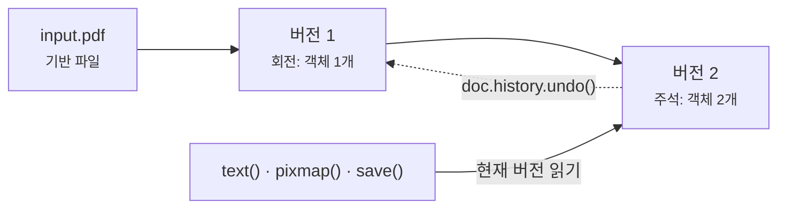

# 핵심 개념

pyropdf는 모든 편집을 하나의 버전 객체 저장소에 기록하고, 모든 페이지를 표시 좌표로 노출합니다. 아래 여섯 가지 규칙이 API의 동작 방식을 설명하며, 끝부분의 [작업에 맞는 API 선택](#choosing-the-operation-for-a-task) 표는 각 작업을 알맞은 진입점으로 안내합니다.

## 표시 좌표 {#display-coordinates}

단어와 검색 결과의 경계 상자, 주석 사각형, `clip`, 페이지 박스를 포함해 API의 모든 사각형과 점은 **표시 좌표(display coordinates)**를 사용합니다. 단위는 1/72인치 포인트이며, 원점은 보이는 페이지의 왼쪽 위 모서리이고 `y` 값은 아래로 갈수록 커집니다. 보이는 페이지는 MediaBox로 잘라낸 CropBox에 페이지 회전을 적용한 영역이므로, `page.rect`는 뷰어에 표시되는 그대로 `(0, 0, width, height)`가 됩니다.

페이지의 `/UserUnit`(PDF 1.6)은 사용자 공간 단위가 1/72인치의 몇 배인지 지정하여 200인치보다 큰 페이지를 표현할 수 있게 합니다. pyropdf는 좌표를 변환하는 모든 곳에 이를 적용합니다. MediaBox가 `[0 0 400 300]`이고 `/UserUnit 2`인 페이지는 `page.rect`, 페이지 박스, 텍스트, 경로, 주석, 캔버스에서 모두 800 × 600포인트가 되며, 72 dpi에서는 800 × 600픽셀로 렌더링됩니다. `/UserUnit`이 없거나 양수가 아니면 1로 취급합니다.

PDF 고유 좌표 공간은 MediaBox의 왼쪽 아래가 원점이며 회전하지 않습니다. pyropdf가 변환을 대신 처리하므로 `search`로 찾은 사각형을 그대로 주석에 넘길 수 있습니다. 사각형을 렌더링된 이미지의 픽셀 좌표로 매핑하려면 `dpi / 72`를 곱합니다.

```python
import pyropdf

with pyropdf.open("input.pdf") as doc:
    page = doc.pages[0]
    dpi = 144
    pixmap = page.pixmap(dpi=dpi)
    x0, y0, x1, y1 = (value * dpi / 72 for value in page.words()[0].bbox)
    print(pixmap.width, round(x0), round(y0), round(x1), round(y1))
```

## 버전

문서는 처음 연 파일(기반)과 그 위에 쌓인 버전들의 연쇄로 이루어집니다. 편집은 변경된 객체만 새 버전에 기록하고, 나머지는 하위 버전과 공유합니다. 읽기, 렌더링, 저장 모두 현재 버전을 대상으로 동작하므로, 저장하지 않고도 바로 다음 `text()`나 `pixmap()` 호출에서 편집 결과를 볼 수 있으며, 특정 버전에만 의존하는 결과는 그 버전에 대해 한 번만 계산됩니다.



`doc.history`는 실행 취소와 다시 실행이 이동하는 단계를 보관합니다. 각 단계는 교체된 객체들을 들고 있으며, `doc.history.size`는 그 바이트 크기를 집계합니다. `doc.history.max_size`로 상한을 설정할 수 있고, `doc.history.clear()`는 문서를 현재 상태로 둔 채 히스토리 단계만 비웁니다.

## 핸들

`Page`, `Annotation`, `Field`, 객체 핸들은 위치가 아니라 대상 자체를 가리킵니다. 페이지 핸들은 페이지가 이동해도 해당 페이지를 따라가며, 실행 취소 이후를 포함해 항상 현재 버전의 내용을 읽습니다. 가리키던 페이지가 삭제된 뒤 핸들을 사용하면 `StalePageError`가 발생하며, 객체 핸들도 마찬가지로 `StaleObjectError`를 발생시킵니다.

```python
import pyropdf

with pyropdf.open("input.pdf") as doc:
    first = doc.pages[0]
    doc.pages.move(0, 1)
    print(first.index)           # 1: the handle followed its page
    del doc.pages[1]
    try:
        first.text()
    except pyropdf.StalePageError:
        print("the page is gone")
```

## 트랜잭션

`doc.transaction(name)`은 블록 안의 편집들을 하나의 단계로 묶습니다. 블록에서 예외가 발생하면 문서는 이전 버전으로 되돌아가며, 이를 위해 문서를 복사하지 않습니다. 트랜잭션 바깥의 편집은 각각 독립된 한 단계가 됩니다. 두 가지 방식은 [버전과 저장](versions.md)에서 다룹니다.

## 스레드

여러 스레드가 하나의 문서를 동시에 읽을 수 있습니다. 읽기 작업은 현재 버전을 가져올 때만 잠금을 잡은 뒤 잠금 없이 진행됩니다. 쓰기 작업은 직렬화되어 완성된 버전을 게시하므로, 다른 스레드가 문서를 편집하는 동안에도 오래 걸리는 렌더링 작업은 시작 시점의 버전을 계속 읽습니다. 렌더링, 텍스트 추출 및 기타 무거운 읽기 작업은 GIL을 해제하며, pyropdf는 CPython의 free-threaded 빌드용 휠도 제공합니다.

```python
from concurrent.futures import ThreadPoolExecutor

import pyropdf

with pyropdf.open("input.pdf") as doc, ThreadPoolExecutor() as pool:
    texts = list(pool.map(lambda page: page.text(), doc.pages))
    print(len(texts))
```

`doc.render`는 기본적으로 여러 스레드에서 페이지를 병렬 렌더링합니다.

## 비용

- 문서를 열 때는 모든 객체가 아니라 상호 참조 데이터만 읽으며, `probe`는 그보다 더 적게 읽습니다.
- 편집 비용은 수정한 범위에 비례합니다. 페이지 회전은 객체 하나만 기록합니다.
- 증분 저장은 편집으로 기록된 객체만 뒤에 추가하고, 전체 저장은 파일을 처음부터 다시 씁니다.
- `DocumentLimits`는 각 작업의 처리량을 제한합니다. [제한과 오류](limits.md)를 참고하세요.

## 작업에 맞는 API 선택 {#choosing-the-operation-for-a-task}

| 작업 | Python API | 다루는 PDF 데이터와 동작 |
| --- | --- | --- |
| 파일 검사 또는 편집 시작 | `probe(source)`, `open(source)`, `Document()` | `probe`는 작은 불변 요약을 반환합니다. `open`은 파일 기반 문서를 열고, 생성자는 빈 문서를 만듭니다. |
| 페이지 찾기, 이동, 복사 | `doc.pages[index]`, `pages.move`, `pages.insert`, `pages.extend` | 인덱스는 위치이며, 페이지 핸들은 이동 후에도 정체성을 유지합니다. 삽입은 다른 문서의 페이지를 포함해 페이지를 복사합니다. 페이지 레이블은 표시 문자열이고, 이름 있는 페이지는 카탈로그 항목입니다. |
| 텍스트, 레이아웃, 그리기 순서 읽기 | `page.text()`, `page.words()`, `page.layout()`, `page.content()` | 용도에 따라 일반 텍스트, 단어 상자, 줄과 스팬, 그려진 항목을 제공합니다. `page.chars()`와 `page.paths()`는 컬럼형 접근을 제공하며, `page.operations`는 편집용 인코딩 그리기 명령을 노출합니다. |
| 검색용으로 선택한 페이지 내보내기 | `doc.text(pages)`, `doc.markdown(pages)`, `doc.to_json(pages)`, `doc.to_chunks(pages)` | 한 버전에서 원하는 페이지를 선택해 일반 텍스트, Markdown, 직렬화된 페이지 요소 또는 경계가 지정된 타입 청크로 내보냅니다. 한 페이지 안의 위치 찾기는 `page.search()`와 `page.selection()`을 사용합니다. |
| 시각적 콘텐츠 또는 오버레이 추가 | `with page.draw() as canvas`, `page.annotations.add(spec)` | 캔버스는 블록이 정상 종료될 때 페이지 콘텐츠 스트림에 기록합니다. 주석은 고유한 사각형과 외형을 가집니다. 탐색 가능한 링크는 `page.links.add(rect, target)`으로 추가합니다. |
| 페이지 렌더링 또는 이미지 추출 | `page.pixmap()`, `doc.render(pages)`, `page.svg()`, `page.images()` | 단일 페이지 래스터화, 일괄 렌더링, 벡터 페이지 내보내기, 개별 이미지 배치 나열을 수행합니다. 각 이미지 항목은 `pixmap()`으로 디코딩된 픽셀을, `stored()`로 저장된 원본 이미지 바이트를 제공합니다. 공유 이미지 교체는 xref로 지정합니다. |
| 글꼴 검사 또는 지정 | `page.fonts()`, `doc.font_program(font)`, `doc.fallback_fonts` | 글꼴 리소스를 나열하고, 특정 임베드 글꼴 프로그램을 추출하며, 대체 글꼴을 설정합니다. 텍스트를 직접 그릴 때는 캔버스에 그리기용 서체를 전달합니다. |
| 폼 필드 값 채우기 또는 외형 변경 | `doc.form[name].value`, `page.widgets[index]` | 필드는 공유 값을 보관하고, 위젯은 페이지 위의 개별 컨트롤을 나타냅니다. `page.widgets.add(spec)`으로 새 위젯을 추가하며, FDF/XFDF 가져오기는 일치하는 필드에 값을 적용합니다. |
| 임베드된 파일 읽기 또는 교체 | `doc.attachments[name]`, `annotation.file` | 전자는 카탈로그 이름 트리 항목을, 후자는 페이지 주석의 파일 명세를 조회합니다. `doc.collection`은 포트폴리오(portable collection)가 파일을 표시하는 방식을 기술합니다. 핸들은 원래 파일 명세에 묶여 있으므로 교체하거나 인라인 항목이 이동한 뒤에는 이름으로 다시 조회해야 하며, 이전 핸들로 접근하면 `StaleObjectError`가 발생합니다. |
| 문서 탐색 구조 다루기 | `doc.outline`, `doc.destinations`, `doc.threads`, `doc.structure` | 북마크는 대상을 가리키고, 이름 있는 목적지는 이름을 해석하며, 아티클 스레드는 페이지 영역 순서를 정하고, 구조 트리는 논리적 읽기 순서를 기술합니다. 액션과 트리거는 해당 이벤트를 소유한 문서, 페이지, 주석 또는 필드에 속합니다. |
| 메타데이터 편집 또는 규격 확인 | `doc.metadata`, `doc.xmp`, `doc.profiles`, `doc.check()` | Info 매핑은 표준 필드를 편집하면서 대응하는 XMP 속성도 함께 갱신합니다. 패킷 자체는 XML이며, `profiles`는 규격 선언과 출력 의도(output intent)를 읽습니다. 구조 검사는 결함을 보고하며, 최종 규격 적합성 검증은 외부 검증기를 사용합니다. |
| PDF/A 선언 읽기 | `doc.profiles.pdfa`, `doc.pdfa_claim` | 표시나 비교에는 `"PDF/A-2B"`처럼 정규화된 이름을 사용하세요. 숫자 파트와 원래 적합성 철자가 필요하면 `(2, "b")` 같은 쌍을 사용합니다. 적합성 레벨이 없는 파트 4는 `(4, "")`를 반환하며, 선언이 없으면 둘 다 `None`을 반환합니다. |
| 저수준 객체 검사 또는 PDF 기능 수정 | `doc.objects[xref]`, `typed.Catalog(doc.catalog)`, 기능별 핸들 | 원시 값은 PDF 이름, 문자열, 참조를 그대로 보존합니다. Arlington 뷰는 스키마 키를 해석합니다. `field.value = text` 같은 기능별 편집은 위젯 외형 등 종속 항목도 함께 유지합니다. |
| 기하 정보 또는 측정 영역 계산 | `rect.top_left`, `point in rect`, `rect.round()`, `rect.area(unit="cm")`, `page.viewports` | 사각형 좌표는 표시 포인트 단위이며, 단위 변환은 지정한 단위를 사용합니다. 뷰포트는 자체 좌표계를 가질 수 있는 PDF 측정 영역입니다. `abs(point)`와 `abs(matrix)`는 유클리드 크기를 반환합니다. |
| 스캔된 텍스트 인식 | `page.ocr()`, `page.apply_ocr(words=words)` | 인식은 위치 정보가 포함된 단어 목록을 반환합니다. 결과를 적용하면 문서에 검색 가능한 텍스트가 기록됩니다. 이미지를 직접 인식하려면 `OcrEngine.recognize`를 사용하세요. |
| 페이지 외형 변경 또는 정보 제거 | `page.recolor(target)`, `doc.rewrite_images()`, `page.clean_contents()`, `doc.flatten()`, `doc.sanitize(path)` | 색상 재지정, 이미지 리소스 재작성, 콘텐츠 스트림 정리, 주석을 페이지에 병합(flatten), 또는 저장 전에 선택한 민감 정보를 제거합니다. 문서 단위와 단일 페이지 단위 작업의 적용 범위가 다릅니다. |
| 표시 상태 및 보기 기본 설정 지정 | `doc.layers`, `doc.viewer_preferences`, `page.transition`, `doc.requirements` | 레이어 구성은 선택적 콘텐츠의 표시 여부를 제어합니다. 나머지 항목은 뷰어 설정, 페이지 전환 효과, 문서가 요구하는 기능을 지정합니다. |
| 접근 제어 및 작업량 제한 | `open(source, password=..., limits=...)`, `doc.unlock(password)`, `doc.save(path, encryption=...)` | 문서를 열 때 비밀번호를 전달하거나 열린 문서를 나중에 잠금 해제합니다. 저장 시 `encryption`으로 출력 정책을 설정합니다. `DocumentLimits`는 문서 작업 전체를, 키워드 전용 `max_*` 매개변수는 개별 결과 크기를 제한합니다. |
| 변경 사항 검토, 서명 및 저장 | `doc.history`, `doc.revisions`, `doc.changes(incremental=True)`, `doc.signatures`, `doc.save(path)`, `doc.to_bytes()` | `history`는 메모리 내 실행 취소 단계이고, `revisions`는 파일에 기록된 증분 저장 세대입니다. `changes`는 규격 선언과 서명된 객체에 미치는 영향을 예측하고, 서명 검증은 기존 서명을 검사합니다. 저장 대상으로 파일 경로 또는 바이트를 선택할 수 있습니다. |

`pages`, `form`, `metadata` 같은 뷰는 이후의 편집 내용을 실시간으로 반영합니다. 시퀀스 뷰는 문서화된 범위에서 음수 인덱스와 슬라이스를 지원하며, 매핑에 없는 키를 조회하면 `KeyError`가 발생합니다. `Profiles` 같은 결과 객체는 이름이 지정된 필드를 가진 불변 레코드이므로 직접 생성할 때는 키워드 인수를 사용하세요. 그리기나 생성 명세 객체는 `TextField("address", rect)`처럼 해당 시그니처에 명시된 피연산자를 전달합니다.
