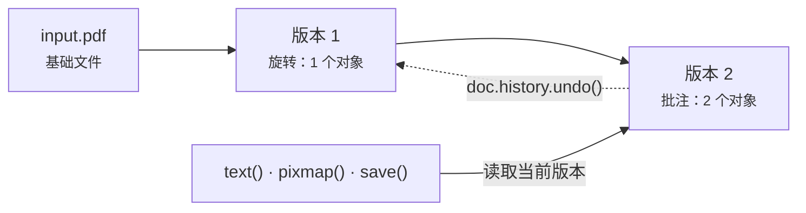

# 核心概念

pyropdf 将所有编辑保存在同一个版本化对象存储中，并以显示坐标统一呈现每一页。以下六条规则概括了 API 的行为方式；文末的[操作对照表](#choosing-the-operation-for-a-task)列出了各类常见任务对应的入口。

## 显示坐标 {#display-coordinates}

API 中的所有矩形与坐标点——包括单词与搜索命中框、批注矩形、`clip` 以及页面边界框——均采用**显示坐标**：单位为 1/72 英寸（磅，point），原点位于可见页面左上角，`y` 轴向下递增。可见页面即经 MediaBox 裁剪后的 CropBox 并应用页面旋转的结果，因此 `page.rect` 始终为 `(0, 0, width, height)`，与 PDF 查看器显示的尺寸完全一致。

页面的 `/UserUnit`（PDF 1.6）以 1/72 英寸的倍数定义用户空间单位，使页面尺寸可以超过 200 英寸。pyropdf 会在所有坐标换算环节应用该比例：一个 MediaBox 为 `[0 0 400 300]` 且 `/UserUnit 2` 的页面，在 `page.rect`、各类页面边界框、文本、路径、批注和画布中均为 800 × 600 磅，在 72 dpi 下渲染为 800 × 600 像素。若 `/UserUnit` 缺失或不是正数，则视为 1。

PDF 自身的坐标系原点在 MediaBox 左下角且不随旋转变化；pyropdf 会自动完成转换，因此 `search` 返回的矩形可直接传入批注。若要将矩形映射到渲染图像的像素坐标，只需乘以 `dpi / 72`：

```python
import pyropdf

with pyropdf.open("input.pdf") as doc:
    page = doc.pages[0]
    dpi = 144
    pixmap = page.pixmap(dpi=dpi)
    x0, y0, x1, y1 = (value * dpi / 72 for value in page.words()[0].bbox)
    print(pixmap.width, round(x0), round(y0), round(x1), round(y1))
```

## 版本

文档由最初打开的文件（基础层）以及叠加其上的一条版本链构成。每次编辑只将修改过的对象写入新版本，其余对象继续与下层版本共享。读取器、渲染器和保存操作始终作用于当前版本，因此编辑无需保存即可立即被随后的 `text()` 或 `pixmap()` 看到；仅依赖单一版本的结果也只会在该版本上计算一次。



`doc.history` 记录供撤销与重做遍历的步骤。每个步骤保留被其替换的对象，`doc.history.size` 统计这些对象占用的字节数；`doc.history.max_size` 可限定总上限，而 `doc.history.clear()` 会清空历史记录同时保持当前文档内容不变。

## 句柄

`Page`、`Annotation`、`Field` 及对象句柄标识的是实体本身，而非它在序列中的位置。当页面被移动时，页面句柄会跟随其指向的页面，并始终读取当前版本中关于该页面的状态（包括撤销之后）。一旦对应的页面被删除，再次使用该句柄会抛出 `StalePageError`；对象句柄同理会抛出 `StaleObjectError`。

```python
import pyropdf

with pyropdf.open("input.pdf") as doc:
    first = doc.pages[0]
    doc.pages.move(0, 1)
    print(first.index)           # 1: the handle followed its page
    del doc.pages[1]
    try:
        first.text()
    except pyropdf.StalePageError:
        print("the page is gone")
```

## 事务

`doc.transaction(name)` 将代码块内的所有编辑合并为单个步骤。如果代码块抛出异常，文档会回退至事务开始前的版本，且无需为此复制文档。事务之外的每次编辑各自构成一个步骤。[版本与保存](versions.md)展示了这两种用法。

## 线程

多个线程可以同时读取同一份文档：读取操作仅在获取当前版本快照时短暂持锁，随后完全无锁执行。写入操作会被串行化并原子发布完整版本，因此即使另一线程正在编辑，耗时较长的渲染任务仍会持续读取启动时的那个版本。渲染、文本提取及其他繁重读取都会释放 GIL，且 pyropdf 为 CPython 自由线程构建提供了专用 wheel 包。

```python
from concurrent.futures import ThreadPoolExecutor

import pyropdf

with pyropdf.open("input.pdf") as doc, ThreadPoolExecutor() as pool:
    texts = list(pool.map(lambda page: page.text(), doc.pages))
    print(len(texts))
```

`doc.render` 本身已支持多线程并行渲染页面。

## 开销

- 打开文档时仅读取交叉引用数据，不会解析所有对象；`probe` 读取的数据更少。
- 编辑开销只与触及的对象有关：旋转页面仅写入一个对象。
- 增量保存只追加编辑写入的对象；完整保存会重写整个文件。
- `DocumentLimits` 可限定每项操作的工作量；详见[限制与错误](limits.md)。

## 按任务选择操作 {#choosing-the-operation-for-a-task}

| 任务 | Python 操作 | 作用的 PDF 数据与说明 |
| --- | --- | --- |
| 检查文件信息或开始编辑 | `probe(source)`、`open(source)`、`Document()` | `probe` 返回精简的不可变摘要；`open` 打开基于文件的文档；构造函数则创建空白文档。 |
| 查找、移动或复制页面 | `doc.pages[index]`、`pages.move`、`pages.insert`、`pages.extend` | 索引代表位置；页面句柄在移动后仍保持指向原页面。插入操作会复制页面，支持从另一文档导入。页码标签是显示字符串，命名页面位于目录（Catalog）条目中。 |
| 读取文本、版面布局或绘制顺序 | `page.text()`、`page.words()`、`page.layout()`、`page.content()` | 纯文本、单词框、行与样式段、按绘制顺序排列的项分别面向不同消费方。`page.chars()` 与 `page.paths()` 提供列式访问；`page.operations` 暴露可供编辑的编码绘制指令。 |
| 导出选定页面用于检索 | `doc.text(pages)`、`doc.markdown(pages)`、`doc.to_json(pages)`、`doc.to_chunks(pages)` | 从同一文档版本选取页面，输出纯文本、Markdown、序列化页面元素或带边界的类型化分块。`page.search()` 与 `page.selection()` 用于定位单页中的内容。 |
| 添加可见内容或叠加批注 | `with page.draw() as canvas`、`page.annotations.add(spec)` | 画布在正常退出代码块时写入页面内容流；批注拥有独立的矩形与外观。`page.links.add(rect, target)` 用于创建可跳转链接。 |
| 渲染页面或提取图像 | `page.pixmap()`、`doc.render(pages)`、`page.svg()`、`page.images()` | 光栅化单页、批量渲染、导出矢量页或列出各次图像绘制实例。每个图像实例通过 `pixmap()` 提供解码后的像素，通过 `stored()` 提供原始存储字节；替换图像则通过 xref 指向共享对象。 |
| 检查或配置字体 | `page.fonts()`、`doc.font_program(font)`、`doc.fallback_fonts` | 分别用于列出页面字体资源、提取指定的嵌入字体程序以及配置替代字体。绘制文字时需向画布提供绘图字体。 |
| 填写表单字段或修改外观 | `doc.form[name].value`、`page.widgets[index]` | 字段保存共享值，其控件（widget）描述在各页面上的具体呈现。`page.widgets.add(spec)` 可新建控件；FDF/XFDF 导入会将值应用到匹配字段。 |
| 读取或替换嵌入文件 | `doc.attachments[name]`、`annotation.file` | 前者解析目录名称树条目，后者对应页面批注的文件规范。`doc.collection` 描述便携式集合如何呈现其中的文件。句柄始终绑定原文件规范；替换后或内联条目发生移动时需按名称重新查询，继续使用旧句柄将抛出 `StaleObjectError`。 |
| 浏览文档导航结构 | `doc.outline`、`doc.destinations`、`doc.threads`、`doc.structure` | 书签指向目标位置，命名目标解析名称映射，文章线索排列页面区域顺序，结构树描述逻辑阅读顺序。动作与触发器归属于对应事件所属的文档、页面、批注或字段。 |
| 编辑元数据或检查合规性 | `doc.metadata`、`doc.xmp`、`doc.profiles`、`doc.check()` | Info 映射编辑标准字段并同步更新匹配的 XMP 属性；XMP 数据包为 XML 格式。`profiles` 读取合规声明与输出意图。结构检查仅报告结构缺陷，完整标准合规验证需借助外部验证器。 |
| 读取 PDF/A 声明 | `doc.profiles.pdfa`、`doc.pdfa_claim` | 用于展示或比较时请使用规范化名称（如 `"PDF/A-2B"`）；若需数字部分与原始一致级别拼写，可使用二元组（如 `(2, "b")`）。第 4 部分无一致级别时返回 `(4, "")`。无声明时两者均返回 `None`。 |
| 检查底层对象或修改 PDF 特性 | `doc.objects[xref]`、`typed.Catalog(doc.catalog)` 或对应特性句柄 | 原始值保留 PDF 名称、字符串与引用；Arlington 视图依据模式（schema）解释键名。`field.value = text` 等特性级编辑还会自动维护相关依赖（包括控件外观）。 |
| 测量几何图形或映射区域 | `rect.top_left`、`point in rect`、`rect.round()`、`rect.area(unit="cm")`、`page.viewports` | 矩形坐标以显示磅为单位，单位换算采用命名单位参数。视口（viewport）是 PDF 的测量区域，可定义独立坐标系。`abs(point)` 与 `abs(matrix)` 返回其欧几里得范数/模长。 |
| 识别扫描文本 | `page.ocr()`、`page.apply_ocr(words=words)` | 识别返回带坐标的单词列表；应用结果后会在文档中写入可搜索文本。`OcrEngine.recognize` 也可直接接收图像。 |
| 修改页面外观或清除信息 | `page.recolor(target)`、`doc.rewrite_images()`、`page.clean_contents()`、`doc.flatten()`、`doc.sanitize(path)` | 分别用于重着色绘制内容、重写图像资源、清理内容流、将批注拼合进页面，或在保存前移除选定的敏感特性。文档级与单页级操作具有不同作用范围。 |
| 设置可见性或阅读偏好 | `doc.layers`、`doc.viewer_preferences`、`page.transition`、`doc.requirements` | 图层配置控制可选内容的显示状态；其余属性分别描述查看器偏好、页面切换效果以及文档要求的查看器能力。 |
| 控制访问权限与工作限额 | `open(source, password=..., limits=...)`、`doc.unlock(password)`、`doc.save(path, encryption=...)` | 打开时传入凭据或随后解锁已打开文档；保存时通过加密选项设置输出策略。`DocumentLimits` 限制文档级操作，仅限关键字的 `max_*` 参数限制单次调用的输出规模。 |
| 审阅、签名与持久化变更 | `doc.history`、`doc.revisions`、`doc.changes(incremental=True)`、`doc.signatures`、`doc.save(path)`、`doc.to_bytes()` | `history` 保存内存中的撤销步骤，`revisions` 表示文件中的增量保存修订版。`changes` 预测变更对合规声明与已签名对象的影响；签名验证用于检查现有签名。保存目标可选文件或字节串。 |

`pages`、`form`、`metadata` 等视图会实时反映后续编辑。序列视图在文档说明范围内支持负索引和切片；访问映射中不存在的键会抛出 `KeyError`。`Profiles` 等返回结果是带命名字段的不可变记录，手动构造时请使用关键字参数。对于绘图或创建规范对象，请按照其签名传入位置参数，例如 `TextField("address", rect)`。
