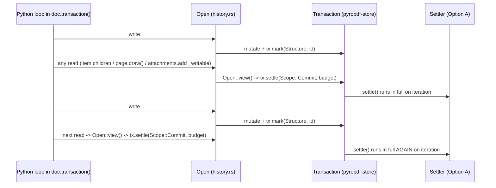
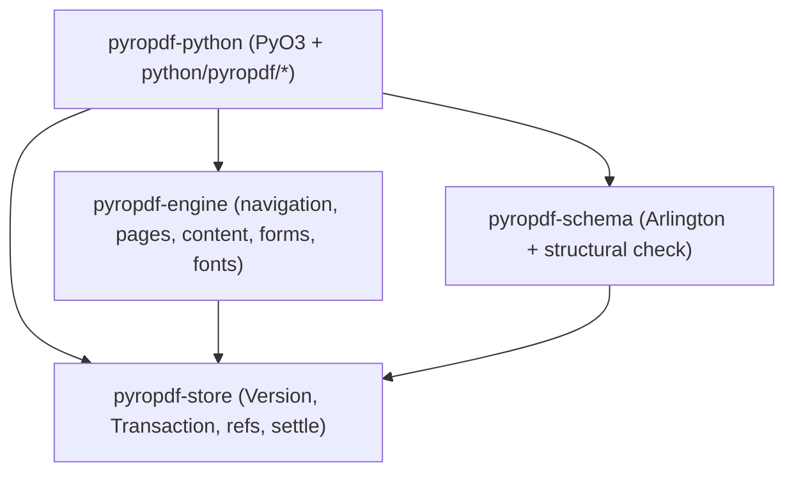

# Structure Settling Evidence (`OutlineCount`, `ParentTree`, `TreeLimits`) — Issue #765

This directory contains the codebase inventory, architectural analysis, and reproducible Rust + Python benchmarks for [issue #765](https://github.com/yhay81/pyropdf/issues/765): deciding whether `Structure::OutlineCount`, `Structure::ParentTree`, and `Structure::TreeLimits` should be:

- **Option A** — migrated to `Settler` implementations registered on `Document` (coalescing updates lazily at `Scope::Commit`);
- **Option B** — ratified as **immediate maintenance**, removing the three dead `Structure` variants from `pyropdf-store` (narrowing `DESIGN.md` §7 lazy settling to `Appearance` and `FontSubset`) and consolidating today's scattered tree/count maintenance into canonical helpers; or
- **Option C** — split per structure (settling only the subset where coalescing wins, removing the rest).

## Executive Summary & Recommendation

**Recommendation: Option B (immediate maintenance + canonical helpers) for all three — `OutlineCount`, `ParentTree`, and `TreeLimits`.**

Option C was seriously evaluated in case `OutlineCount` benefited from a `Settler` while `ParentTree` and `TreeLimits` stayed immediate. Prototyping both options revealed that **Option B strictly dominates both Option A and Option C across all three structures**:

1. **Every Python read inside an open transaction settles `Scope::Commit` (`Open::view()`).** In `crates/pyropdf-python/src/history.rs:104-116, 277-340`, `_Document::reading()` calls `Open::view()`, which runs `transaction.settle(Scope::Commit, budget)` whenever a prior `edit()` invalidated `open.snapshot`. Consequently, **Option A achieves zero coalescing in realistic Python loops that interleave reads and writes** (`if item.children: item.is_open = False`, multi-page `with page.draw() as c:` inside `doc.transaction()`, and `doc.attachments.add(...)` which calls `_writable()` -> `reading()` on every insertion).
2. **`OutlineCount` has an $O(\text{depth})$ immediate algorithm that beats Option A in both pure and interleaved batches.** PDF stores open/closed state solely as the sign of `/Count` (ISO 32000-2 Table 151 — there is no `/Open` boolean), so even Option A must read and write each toggled item's `/Count` at setter time. Propagating the $\pm|\text{Count}|$ delta up `/Parent` pointers (stopping above any closed ancestor with `/Count < 0`, falling back to a full walk only when an input PDF lacks consistent `/Parent` or `/Count`) reduces a single toggle on a 2,048-item outline from **2,036.8 µs** (2,051 reads) to **3.7 µs** (2 reads) — **31.8× faster** than Option A (`117.7 µs`), **1.35× faster** than Option A on 64 pure-write toggles (`265.5 µs` vs `358.2 µs`), and **8.1× faster** than Option A on 64 interleaved toggles (`1,077.8 µs` vs `8,751.9 µs`).
3. **`ParentTree` already coalesces within a single canvas and within page copy/import.** A single `Canvas` emits one Form XObject with one `/StructParents` key regardless of whether it draws 10 or 200 tagged elements (`ParentTreeNextKey` advances by `1`). Across multiple canvases in `with doc.transaction():`, `page.draw()` reads page geometry via `Open::view()` before each canvas, forcing Option A's settler to run on every page (**128 settler runs** across 64 pages: `13,311.1 µs`, 832 reads) versus Option B's bounded-leaf immediate helper (**0 settler runs**: `11,283.9 µs`, 256 reads).
4. **`TreeLimits` costs zero extra reads and zero extra writes when maintained inline.** Any mutator of `/Names`, `/Nums`, or `/Kids` already holds the copied `Dict` in memory and writes it via `tx.write`. Setting `/Limits = [first, last]` inline beats Option A on **every single benchmark row** (both `pure` and `interleaved`, `ops = 1, 16, 64`), keeps `/Limits` valid for $O(\log N)$ tree routing throughout the transaction, and avoids Option A's second `version.get` + `copy_for_edit` + `tx.write` pass.
5. **Consolidating immediate helpers fixes two latent bugs uncovered during the inventory:**
   - **Orphaned `/Kids` nodes on flatten:** `python/pyropdf/_attachments.py` (`_rewrite`) and `python/pyropdf/_page_labels.py` (`_write_page_labels`) flatten multi-level `/Kids` trees into a single root dictionary without freeing the old indirect `/Kids` nodes (leaving `3/4` `/Kids` leaves orphaned on `del doc.attachments[k]` and `4/4` orphaned on `doc.attachments.add(...)`).
   - **Multi-level `/ParentTree` divergence:** `python/pyropdf/_canvas/_tags.py` walks down `kids[-1]` to the rightmost leaf without splitting leaves ($O(P^2)$ leaf growth), whereas `pages/copy.rs` and `pages/import/graft.rs` append new leaves directly to root `tree["Kids"]` (which would mix leaf nodes with intermediate nodes on a tree of depth $\ge 2$).

---

## 1. Complete Inventory of `Structure` Variants, Read Sites, and Write Sites

### 1.1 Settling Infrastructure Touchpoints

| Crate / File | Lines | Role |
| :--- | :--- | :--- |
| `crates/pyropdf-store/src/settle/mod.rs` | L44-112 | Declares `Structure::{Appearance, OutlineCount, ParentTree, TreeLimits, FontSubset}`, `Scope::{Commit, Save}`, `Structure::ALL`, `Structure::index()`, `Settler`, `Settlers`. Only `Appearance` (`crates/pyropdf-python/src/forms.rs:94-114`) and `FontSubset` (`crates/pyropdf-python/src/fonts.rs:144-169`, `Scope::Save`) have production `Settler` implementations. |
| `crates/pyropdf-store/src/version/stale.rs` | L14-21 | `Stale { marks: [Table<()>; Structure::ALL.len()] }` — embeds 5 persistent chunk-table roots (`5 × 16 B = 80 B`) in every `Version` and `Transaction`. |
| `crates/pyropdf-store/src/version/journal.rs` | L170, L291-295 | Serializes `Mark.structure` in saved undo history (`FORMAT = 1`) as `mark.structure.index() as u8` (`Appearance = 0, OutlineCount = 1, ParentTree = 2, TreeLimits = 3, FontSubset = 4`). **Wire-compatibility hazard:** deleting variants 1..3 without explicit wire tag mapping would shift `FontSubset` from `4` to `1`. |
| `crates/pyropdf-python/src/history.rs` | L104-116, L277-340 | `Open::view()` runs `transaction.settle(Scope::Commit, budget)` before publishing an intra-transaction read snapshot whenever `open.snapshot` is `None` (invalidated by any `edit()`). |
| `crates/pyropdf-python/src/history/testing.rs` | L95, L108 | Test-only `_test_arm_panic_settler` / `_test_mark_for_panic` uses `Structure::TreeLimits` on a test `Settlers` override; trivial 2-line switch to `Structure::Appearance`. |
| `crates/pyropdf-store/src/settle/tests.rs` | L116-207 | Unit tests for `Scope::One` isolation and multi-settler `MAX_ROUNDS` cycle detection use `Appearance` + `TreeLimits`; can use a `#[cfg(test)]` commit-scoped variant if `TreeLimits` is removed. |

### 1.2 `OutlineCount` (`/Outlines` and Outline Item `/Count`)

> **Correction to `#765` Context:** `crates/pyropdf-store/src/refs/navigation.rs` (`plan` at L86-89, L214-216, L341) does **not** recompute `/Count`. On page deletion, `refs/navigation.rs` either removes `/Outlines` from `/Catalog` altogether (when zero pages remain) or applies `Rule::Unresolve` to strip `/Dest`/`/A` from affected outline items while keeping every item in the hierarchy — so no `/Count` changes during `remove_pages`. Likewise, `outline_set_title`, `outline_set_target`, and `outline_set_style` do not alter `/Count`.

| Direction | Crate / File | Function / Lines | Behavior |
| :--- | :--- | :--- | :--- |
| **Read** | `crates/pyropdf-engine/src/navigation/outline.rs` | `walk` (L504), `outline_item` (L570), `counts` (L1230) | Reads `Count > 0` on items with `/First` as `is_open` (ISO 32000-2 Table 151). |
| **Read** | `crates/pyropdf-schema/src/generated.rs` | `Outline` (L3905), `OutlineItem` (L3914) | Arlington schema check (`Outline/Count >= 0`, `OutlineItem/Count` integer). |
| **Read** | `python/pyropdf/_outline.py` | `OutlineItem.is_open` (L226-227), `to_entry` (L252), `entries` (L337) | Exposes item open/closed state from `outline_item` / `outline_entries`. |
| **Write** | `crates/pyropdf-engine/src/navigation/outline.rs` | `outline_write` (L697-896, `/Count` at L803-832, L874) | Full replacement (`doc.outline = entries`): computes all visible counts in one $O(N)$ reverse pass in memory before allocating objects; writes each item once. |
| **Write** | `crates/pyropdf-engine/src/navigation/outline.rs` | `outline_set_open` (L1083-1273) | Single-item `item.is_open = flag`: currently calls `counts()`, walking **all $N$ outline items** on every call ($O(K \cdot N)$ for $K$ toggles). |

### 1.3 `ParentTree` (`/StructTreeRoot` `/ParentTree` and `/ParentTreeNextKey`)

> **Correction to `#765` Context:** A Tagged PDF `Canvas` does **not** update `/ParentTree` per tagged element. `Canvas._commit` (`python/pyropdf/_canvas/_canvas.py:617`) wraps all drawings of the canvas into a single Form XObject carrying one `/StructParents` key and calls `_add_parent_tree_entry` **once per canvas exit**.

| Direction | Crate / File | Function / Lines | Behavior |
| :--- | :--- | :--- | :--- |
| **Read** | `crates/pyropdf-store/src/refs/structure.rs` | `parent_tree` (L172-208) | Reads `/StructTreeRoot` -> `/ParentTree` and collects number-tree nodes via `Edits::number_tree` during page deletion. |
| **Read** | `crates/pyropdf-engine/src/pages/copy.rs` | `Structure::read` (L347-366), `parent_tree_pairs` (L763-808) | Walks `/ParentTree` (`MAX_TREE_DEPTH = 64`) when duplicating pages within a document. |
| **Read** | `crates/pyropdf-engine/src/pages/import/graft.rs` | `Graft` (L185-195), `Receiving::read` (L673-700) | Walks source and destination `/ParentTree` and `/ParentTreeNextKey` during cross-document page import. |
| **Read** | `python/pyropdf/_canvas/_tags.py` | `_add_parent_tree_entry` (L234-255) | Walks rightmost `/Kids` chain from `/ParentTree` to last `/Nums` leaf and reads `/ParentTreeNextKey`. |
| **Read** | `crates/pyropdf-schema/src/check/mod.rs` | `structure` (L1011-1062), `order` (L1088-1154) | Validates `/ParentTree` number-tree ordering, `/Limits`, and `/ParentTreeNextKey > max_key`. |
| **Write** | `crates/pyropdf-store/src/refs/structure.rs` | `parent_tree` (L210-236) + `refs/rules.rs` | Prunes removed-page entries from `/ParentTree` in one batch pass per `remove_pages` call; leaves `/ParentTreeNextKey` monotonic. |
| **Write** | `crates/pyropdf-engine/src/pages/copy.rs` | `Structure::finish` (L657-756) | Batches all remapped `(key, value)` pairs for one copy operation into 64-pair leaves and advances `/ParentTreeNextKey` once. *(Appends leaves directly to root `tree["Kids"]`.)* |
| **Write** | `crates/pyropdf-engine/src/pages/import/graft.rs` | `Graft::finish` (L454-608) | Batches all grafted `(key, value)` pairs for one import operation into 64-pair leaves and advances `/ParentTreeNextKey` once. *(Also appends directly to root `tree["Kids"]`.)* |
| **Write** | `python/pyropdf/_canvas/_tags.py` | `_add_parent_tree_entry` (L227-261) | Appends `[key, owners]` to rightmost `/Nums` leaf without splitting leaves, updates path `/Limits`, and increments `/ParentTreeNextKey`. |

### 1.4 `TreeLimits` (Name-Tree and Number-Tree `/Limits`)

| Tree | Read Sites | Write Sites | Current `/Limits` Handling |
| :--- | :--- | :--- | :--- |
| **Generic pruning (`remove_pages`)** | `refs/roles.rs:325`, `refs/rules.rs:422, 448, 484, 501`, `schema/src/check/mod.rs:1088-1154` | `crates/pyropdf-store/src/refs/rules.rs` (`Edits::process` / `Edits::settle`, L328-510) | Already batch-coalesces all removed entries across `/Dests`, `/AP`, `/Pages`, `/Templates`, `/IDS`, `/URLS`, `/EmbeddedFiles`, `/AlternatePresentations`, `/Renditions`, `/PageLabels`, `/Nums`, `/ParentTree`, `/IDTree` in one bottom-up pass per `remove_pages`, updating `/Limits` on surviving `/Kids` and removing `/Limits` on single-node roots. |
| **`/ParentTree`** | See §1.3 | `pages/copy.rs:687-734`, `pages/import/graft.rs:465-504`, `_canvas/_tags.py:257-259` | Immediate inline `/Limits` on `/Kids` leaves; absent on single-node root. |
| **`/IDTree`** | `pages/import/graft.rs:614-621`, `schema/src/check/mod.rs:1098` | `pages/import/graft.rs:609-633`, `refs/structure.rs:124-131` | Rewritten as flat root `/Names` during graft (no `/Limits`); pruned by `Edits` on `remove_pages`. |
| **`/PageLabels`** | `refs/labels.rs:35-103`, `_page_labels.py:214-269`, `schema/src/check/mod.rs:1093` | `refs/labels.rs:158-163` (`relabel`), `_page_labels.py:290` (`_write_page_labels`) | Written as flat root `/Nums` (no `/Limits`). `refs/labels.rs` frees old `Labels::nodes()`; `_page_labels.py:290` overwrites `doc.catalog["PageLabels"]` without freeing prior `/Kids` nodes. |
| **`/Names /EmbeddedFiles`** | `_attachments.py:181-235` (`_walk`, `_lookup`), `schema/src/check/mod.rs:1095` | `python/pyropdf/_attachments.py:577-607` (`_rewrite`) | Flattens entire tree to root `/Names`, deleting `/Kids` and `/Limits` on every `add` / `del` / rename without freeing prior `/Kids` nodes. |
| **`/Names /Dests`** | `navigation/destinations.rs:47-105`, `_links.py` | `refs/navigation.rs` (`Edits` on `remove_pages` only) | `Destinations` is read-only in Python; `Edits` maintains `/Limits` during page deletion. |

---

## 2. Why `Open::view()` Prevents Settler Coalescing in Python Loops

`DESIGN.md` §7 envisioned commit-scoped settlers coalescing repeated mutations inside an explicit `with doc.transaction():` block. However, `crates/pyropdf-python/src/history.rs` enforces read-your-own-writes consistency inside open transactions via `Open::view()`:



This is not an accidental quirk that can be skipped:

- If `Open::view()` did **not** settle `Scope::Commit`, mid-transaction reads (`doc.outline`, `item.is_open`, `doc.check()`, `doc.pages.copy()`, `doc.attachments[name]`) would observe invalid PDF dictionaries (`Outline/Count` disagreeing with children, missing `/ParentTree` entries for newly drawn canvases, or stale `/Limits` routing lookups to the wrong leaf).
- Because `Open::view()` **does** settle `Scope::Commit`, every realistic Python loop that inspects state between writes triggers $K$ full settler runs across $K$ iterations:
  1. `for item in items: if item.children: item.is_open = False` -> `outline_children` calls `reading_parent()` -> settles on every iteration.
  2. `with doc.transaction(): for page in doc.pages: with page.draw() as c: ...` -> `Canvas._commit` calls `_page_space(page)` (`reading()`) -> settles on every page.
  3. `with doc.transaction(): for name, data in files: doc.attachments.add(name, data)` -> `add()` calls `_writable(self._document)` (`reading()`) -> settles on every attachment.

---

## 3. Comparison Across the Four Decision Dimensions

### Dimension 1: Multi-Step Transaction Coalescing Cost

Full raw tables are in [`results/macos-arm64.md`](results/macos-arm64.md) and [`results/macos-arm64.csv`](results/macos-arm64.csv) (Apple M2 Pro, `rustc 1.99.1`, `--release` with `lto = "thin"`). Selected representative rows:

#### A. `OutlineCount` (`N = 2048` outline items across 3 levels)

| Ops | Mode | Variant | Settler runs | Store reads | Store writes | Changed objs | Median (µs) |
| --: | :--- | :------ | -----------: | ----------: | -----------: | -----------: | ----------: |
| 1 | `pure` | `current_eager_full_walk` | 0 | 2,051 | 2 | 2 | 2,036.8 |
| 1 | `pure` | `option_a_settler` | 1 | 2,051 | 2 | 2 | 117.7 |
| 1 | `pure` | **`option_b_parent_delta`** | **0** | **2** | **2** | **2** | **3.7** |
| 64 | `pure` | `current_eager_full_walk` | 0 | 131,264 | 128 | 65 | 137,928.3 |
| 64 | `pure` | `option_a_settler` | 1 | 2,114 | 65 | 65 | 358.2 |
| 64 | `pure` | **`option_b_parent_delta`** | **0** | **128** | **128** | **65** | **265.5** |
| 64 | `interleaved` | `current_eager_full_walk` | 0 | 132,288 | 128 | 65 | 137,817.4 |
| 64 | `interleaved` | `option_a_settler` | 64 | 132,288 | 128 | 65 | 8,751.9 |
| 64 | `interleaved` | **`option_b_parent_delta`** | **0** | **1,152** | **128** | **65** | **1,077.8** |

- On `main` today (`measure_python.py`), toggling 64 chapters on a 2,048-item outline takes **142.6–165.3 ms** — **12× slower** than replacing the entire 2,048-item outline with `doc.outline = entries` (**12.2 ms**).
- Option A still walks all 2,048 items on a single toggle (`117.7 µs`) and degrades to 64 full walks (`8,751.9 µs`, 132,288 reads) when `item.children` is read in the loop.
- Option B's $O(\text{depth})$ `/Parent`-chain delta propagation wins in **every** regime (`3.7 µs` for 1 toggle, `265.5 µs` for 64 pure toggles, `1,077.8 µs` for 64 interleaved toggles), eliminating the only plausible case for **Option C**.

#### B. `ParentTree` (`initial = 256` entries across 4 leaves, `MCIDS_PER_CANVAS = 4`)

| Ops (canvases) | Mode | Variant | Settler runs | Store reads | Store writes | Changed objs | Median (µs) |
| -------------: | :--- | :------ | -----------: | ----------: | -----------: | -----------: | ----------: |
| 1 | `pure` | `current_unsplit_leaf` | 0 | 4 | 7 | 7 | 104.2 |
| 1 | `pure` | `option_a_settler` | 2 | 12 | 9 | 8 | 117.9 |
| 1 | `pure` | **`option_b_bounded_immediate`** | **0** | **3** | **8** | **8** | **104.3** |
| 64 | `pure` | `current_unsplit_leaf` | 0 | 256 | 448 | 322 | 13,792.8 |
| 64 | `pure` | `option_a_settler` *(idealized)* | 2 | 579 | 387 | 323 | 10,315.9 |
| 64 | `pure` | **`option_b_bounded_immediate`** | **0** | **192** | **449** | **323** | **11,345.7** |
| 64 | `interleaved` | `current_unsplit_leaf` | 0 | 320 | 448 | 322 | 13,870.7 |
| 64 | `interleaved` | `option_a_settler` *(real canvas loop)* | 128 | 832 | 513 | 323 | 13,311.1 |
| 64 | `interleaved` | **`option_b_bounded_immediate`** | **0** | **256** | **449** | **323** | **11,283.9** |

- Within a single canvas (`measure_python.py`), 10, 50, and 200 `tag('P')` scopes all write `/ParentTree` **once** (`ParentTreeNextKey=1`).
- Across 64 canvases in a transaction, the real Python execution path is `interleaved` (because `page.draw()` reads page geometry before each canvas), where Option B (`11,283.9 µs`, 256 reads, 0 settler runs) beats Option A (`13,311.1 µs`, 832 reads, 128 settler runs) even when Option A is given an idealized fine-grained `StructElem` mark.

#### C. `TreeLimits` (`initial = 256` `/EmbeddedFiles` entries across 4 leaves)

| Ops | Mode | Variant | Settler runs | Store reads | Store writes | Changed objs | Median (µs) |
| --: | :--- | :------ | -----------: | ----------: | -----------: | -----------: | ----------: |
| 1 | `pure` | `current_flat_rewrite` | 0 | 9 | 3 | 3 | 48.2 |
| 1 | `pure` | `option_a_settler` | 1 | 3 | 3 | 3 | 22.4 |
| 1 | `pure` | **`option_b_bounded_immediate`** | **0** | **2** | **3** | **3** | **13.0** |
| 16 | `interleaved` | `current_flat_rewrite` | 0 | 55 | 48 | 33 | 1,690.9 |
| 16 | `interleaved` | `option_a_settler` | 16 | 121 | 53 | 41 | 412.1 |
| 16 | `interleaved` | **`option_b_bounded_immediate`** | **0** | **104** | **50** | **41** | **334.3** |
| 64 | `pure` | `current_flat_rewrite` | 0 | 135 | 192 | 129 | 7,645.0 |
| 64 | `pure` | `option_a_settler` | 1 | 361 | 197 | 137 | 1,356.3 |
| 64 | `pure` | **`option_b_bounded_immediate`** | **0** | **353** | **194** | **137** | **1,337.7** |
| 64 | `interleaved` | `current_flat_rewrite` | 0 | 199 | 192 | 129 | 7,422.9 |
| 64 | `interleaved` | `option_a_settler` | 64 | 482 | 198 | 137 | 1,622.1 |
| 64 | `interleaved` | **`option_b_bounded_immediate`** | **0** | **417** | **194** | **137** | **1,363.4** |

- Option B beats Option A on **every single row** (`pure` and `interleaved`, `ops = 1, 16, 64`), and is **5.4–5.7× faster** than today's flat-array rewrite (`_attachments.py`) at `ops = 64`.

---

### Dimension 2: Error and `LimitCode` Attribution (Setter Call vs Transaction Commit)

| Aspect | Option A (`Settler` at `Scope::Commit`) | Option B (Immediate Maintenance) |
| :--- | :--- | :--- |
| **Where `LimitError` / `MalformedPdfError` surfaces** | Deferred to the next `Open::view()` read or `with doc.transaction():` `__exit__` (`commit()`), far from the setter/edit call that caused it. | Raised synchronously at the exact Python/Rust call (`item.is_open = ...`, `canvas.__exit__`, `doc.attachments.add(...)`) whose input or traversed graph exceeded the budget or encountered malformed structure. |
| **Sticky-mark poisoning inside `doc.transaction()`** | In `Transaction::settle` (`crates/pyropdf-store/src/version/transaction.rs:329-331`, verified by `settle/tests.rs:302-318`), when a settler returns `Err(e)`, `self.rollback(savepoint)` rolls back only the settler's own writes while **preserving the `Stale` mark** made by the earlier setter. Any `try: bad_op() except PdfError: pass` inside `doc.transaction()` cannot catch the error at `bad_op()`, and once the settler fails on a later read or commit, the entire transaction is poisoned. | `Open::edit()` (`history.rs:325-340`) wraps each individual setter/operation in a `Savepoint` (`restore_on_error`): if an operation exceeds `Budget` (`ObjectCount`, `Depth`, `Memory`) or hits malformed structure, `restore_on_error` rolls back that step cleanly at the call site, leaving any enclosing `doc.transaction()` healthy. |
| **Operation-scoped `Budget` accounting** | Settler work runs under whichever `Budget` happens to trigger `Open::view()` or `end_transaction` (`self.budget()`), divorcing tree/outline traversal cost from per-operation limits (such as `Canvas._operation` budget in `_canvas.py:251`). | Tree/count maintenance is charged directly to the active operation's `Budget` (`Canvas._operation`, `outline_set_open`, `remove_pages`, `copy_pages`, `import_pages`). |

---

### Dimension 3: Savepoint, Undo, and Saved-History (`journal.rs`) Behavior

| Mechanism | Option A (`Settler`) | Option B (Immediate Maintenance) |
| :--- | :--- | :--- |
| **`Savepoint` (`tx.savepoint()` / `tx.rollback()`)** | Must snapshot and restore 5 `Stale` tables (`[Table<()>; 5]`) alongside `version.table`. Worse, rolling back to a savepoint taken *after* a setter still retains the unsettled `Stale` mark, whereas rolling back *around* a settler leaves the mark dirty again. | `Savepoint` snapshots `version.table` where invariants already hold at every step boundary. `Stale` shrinks from 5 `Table<()>` roots (**80 B**) to 2 (`Appearance`, `FontSubset`: **32 B**) on every `Version`, `Transaction`, and `Savepoint`. |
| **Undo / Redo (`Document::undo` / `redo`)** | Committed versions have `Scope::Commit` marks cleared, so undo/redo between committed versions is identical, at the cost of carrying 3 always-empty `Table<()>` roots per `Version` in history. | Every committed `Version` is already self-consistent (`OutlineCount`, `ParentTree`, `TreeLimits` satisfied), with zero `Scope::Commit` marks other than `Appearance`. |
| **Saved History (`Document::save_history` / `restore_history`)** | Keeps all 5 `Structure` indices (`0..=4`) in `journal.rs` (`FORMAT = 1`), though indices `1, 2, 3` are never written into committed `Version`s (`Scope::Commit` settles before `commit()` publishes a `Version`; only `Scope::Save` marks — i.e., `FontSubset` — persist on committed versions!). | **Action item for Option B implementation:** Because `Scope::Commit` structures are drained before `Transaction::commit()` builds a `Version`, no valid saved history contains `OutlineCount (1)`, `ParentTree (2)`, or `TreeLimits (3)` marks — **only `FontSubset` (currently wire byte `4`) can appear in a committed `Version`'s `stale` set** (or `Appearance (0)` in synthetic store unit tests). When removing `OutlineCount`, `ParentTree`, and `TreeLimits` from `Structure`, `journal.rs` **must** encode/decode explicit wire tags (`0 => Appearance`, `4 => FontSubset`, rejecting `1..=3` or bumping `FORMAT`) rather than raw `Structure::index()`, or existing `FORMAT = 1` saved histories with `FontSubset` marks would fail `structure_from_index` on restore. |

---

### Dimension 4: Crate-Boundary Ownership (`pyropdf-store` vs `pyropdf-engine` vs `pyropdf-python`)

`DESIGN.md` §11 (`tests/test_crate_dependencies.py`) enforces a strict DAG:



Comparing ownership under Option A vs Option B:

1. **Why `Appearance` and `FontSubset` belong in `Settler`, while the other three do not:**
   - Generating widget appearances (`Appearance`) needs font metrics, text shaping (`harfrust`), and content stream synthesis (`pyropdf-engine`), while form field values can also be mutated from `pyropdf-store` (`refs/forms.rs`) or `pyropdf-python`. Subsetting embedded font programs (`FontSubset`, `Scope::Save`) needs full-document glyph usage analysis across pages (`pyropdf-engine`) and only makes sense at `save` / `to_bytes`. Both genuinely bridge `pyropdf-store` -> `pyropdf-engine` via `Settlers` injected by `pyropdf-python`.
   - By contrast, name trees, number trees, and `/ParentTree` are pure PDF dictionary/array data structures (`Dict`, `Array`, `Name`, `PdfString`, `Integer`, `Reference`) whose types live 100% inside `pyropdf-store`! Putting them behind `Settler` either forces every `Document` caller in Rust tests and `pyropdf-python` to wire up settlers for store-native structures, or splits tree invariants across `pyropdf-store` (mutation) and `pyropdf-python` (settler registration).
2. **Clean ownership under Option B:**
   - **`pyropdf-store`** owns a single canonical **`tree` helper module** (name trees, number trees, and `/ParentTree` append/insert/remove/flatten-free with 64-pair leaf splitting, multi-level `/Kids` descent + ancestor `/Limits` propagation, and `free_unreferenced` cleanup of retired `/Kids` nodes).
     - Used directly by `pyropdf-store::refs` (`rules.rs`, `labels.rs`, `structure.rs`),
     - Used directly by `pyropdf-engine::pages` (`copy.rs`, `import/graft.rs`), eliminating ~180 lines of duplicated leaf-building code and fixing multi-level `/ParentTree` handling,
     - Exposed via `pyropdf-python` (`_core`) so `_canvas/_tags.py`, `_attachments.py`, and `_page_labels.py` use the exact same bounded-leaf + orphan-freeing implementation instead of ad-hoc Python dictionary rewrites.
   - **`pyropdf-engine::navigation`** owns `outline_write` and `outline_set_open` (upgraded to $O(\text{depth})$ `/Parent`-chain delta propagation with automatic fallback to `counts()` on malformed/legacy outlines). `pyropdf-store` needs zero knowledge of outline item `/Count` semantics.

---

## 4. Recommended Follow-Up Issues (After Owner Decision on #765)

Once the owner records a decision selecting **Option B** on `#765`, open and execute these four scoped follow-up tasks (respecting `AGENTS.md`: a `DESIGN.md` change is its own pull request):

1. **Doc PR (`DESIGN.md` §7): Narrow lazy settling to `Appearance` and `FontSubset`**
   - **Paths:** `DESIGN.md`
   - **Scope:** Update §7 (*Lazy Derived-Structure Settling*) so the settled-structure table lists `Appearance` (`Scope::Commit`) and `FontSubset` (`Scope::Save`), and explicitly states that `OutlineCount`, `ParentTree` (`/ParentTreeNextKey`), and name-/number-tree `/Limits` are maintained immediately at mutation sites via canonical store/engine helpers, citing `evidence/structure-settling/`.
2. **Store PR: Remove dead `Structure::{OutlineCount, ParentTree, TreeLimits}` variants while preserving saved-history wire compatibility**
   - **Paths:** `crates/pyropdf-store/src/settle/`, `crates/pyropdf-store/src/version/journal.rs`, `crates/pyropdf-store/src/version/tests.rs`, `crates/pyropdf-python/src/history/testing.rs`
   - **Scope:** Remove `OutlineCount`, `ParentTree`, and `TreeLimits` from `Structure` (shrinking `Stale` from 5 tables to 2 in non-test builds; keep a `#[cfg(test)]` commit-scoped variant or test fixture for multi-structure `Scope::One` and `MAX_ROUNDS` tests in `settle/tests.rs`); switch `history/testing.rs` panic-settler test hook from `Structure::TreeLimits` to `Structure::Appearance`; preserve `journal.rs` `FORMAT = 1` wire tags (`0` for `Appearance`, `4` for `FontSubset`) with a regression test restoring a saved history containing a `FontSubset` mark.
3. **Store + Engine + Python PR: Consolidate name-tree, number-tree, and `/ParentTree` mutations onto canonical `pyropdf-store` helpers**
   - **Paths:** `crates/pyropdf-store/src/tree/` (or `refs/`), `crates/pyropdf-engine/src/pages/copy.rs`, `crates/pyropdf-engine/src/pages/import/graft.rs`, `crates/pyropdf-python/src/`, `python/pyropdf/_canvas/_tags.py`, `python/pyropdf/_attachments.py`, `python/pyropdf/_page_labels.py`, `tests/`
   - **Scope:** Provide one bounded-leaf (64 pairs), depth-bounded (`MAX_TREE_DEPTH = 64`) name-/number-tree and `/ParentTree` mutator in `pyropdf-store` that maintains `/Limits` inline on non-root nodes, handles multi-level `/Kids` trees consistently across canvas tagging and page copy/import, and frees retired `/Kids` nodes when trees shrink or are replaced (fixing orphaned `/Kids` in `_attachments.py` and `_page_labels.py`, with Python regression tests).
4. **Engine PR: Maintain outline `/Count` in $O(\text{depth})$ via `/Parent`-chain delta in `outline_set_open`**
   - **Paths:** `crates/pyropdf-engine/src/navigation/outline.rs`, `tests/test_outline.py`
   - **Scope:** Update `outline_set_open` to propagate $\pm|\text{Count}|$ along `/Parent` up to `/Outlines` (stopping upward propagation when a closed ancestor's negative `/Count` is updated, and falling back to full `counts()` when `/Parent` or `/Count` on an input PDF is missing, cyclic, or inconsistent), plus differential tests verifying exact `/Count` agreement with `outline_write` across nested open/closed combinations.

---

## 5. Reproducing the Measurements

From the repository root (requires no changes to root `Cargo.toml` or `Cargo.lock`):

```bash
./evidence/structure-settling/run.sh
```

This builds `evidence/structure-settling` in `--release --locked` mode, runs all 54 Rust store/engine microbenchmark configurations (`src/outline.rs`, `src/parent_tree.rs`, `src/name_tree.rs`), runs the 22 end-to-end Python workflow measurements (`measure_python.py`), and writes:

- `evidence/structure-settling/results/<os>-<arch>.md`
- `evidence/structure-settling/results/<os>-<arch>.csv`
- `evidence/structure-settling/results/<os>-<arch>-python.json`
